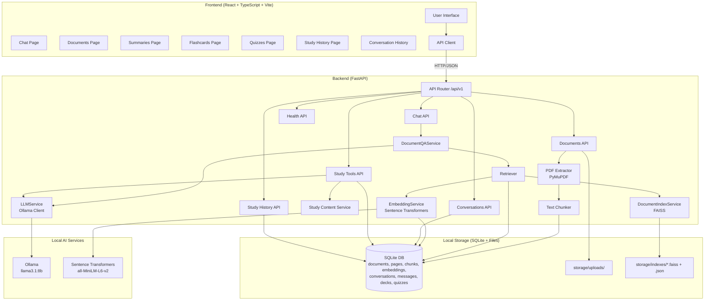

# StudyMate AI Architecture

## System Overview

StudyMate AI is a local-first RAG application with a React frontend, FastAPI backend, SQLite database, FAISS vector store, and Ollama LLM. The frontend and backend run as separate local processes; the backend does not serve the Vite development build.

### Execution model

- **Single user, local only**: no authentication or user isolation. The backend binds to `127.0.0.1` by default.
- **Synchronous requests**: upload extraction, retrieval, and LLM generation finish inside the HTTP request. There is no job queue or streaming.
- **Local processes**: a Python 3.12 virtual environment for the API, Node/Vite for the frontend, and Ollama on `127.0.0.1:11434` for generation.
- **Persistent local state**: SQLite and files under `backend/storage/`; they are git-ignored. Indexes can be rebuilt from uploaded PDFs. Conversations and saved study sets are lost if the database is deleted.
- **One-time setup downloads**: Ollama pulls `llama3.1:8b`, and Sentence Transformers downloads `all-MiniLM-L6-v2` from Hugging Face on first use. After that, documents and inference stay local.

## Architecture Diagram

## Component Responsibilities

### Frontend
- **ChatPage**: Document selection, question input, message display with citations
- **Conversation History**: List, create, rename, delete conversations
- **DocumentsPage**: Upload, list, delete PDFs
- **SummariesPage**: Generate and display document summaries
- **FlashcardsPage**: Generate or reopen saved decks, flip cards, navigate, and show source state
- **QuizzesPage**: Generate or reopen saved quizzes, select answers, submit for server-side scoring, and reveal explanations after submission
- **StudyHistoryPage**: List saved decks/quizzes, show scores and source warnings, reopen by query param, and delete with confirmation
- **API Client**: Typed HTTP client for all backend endpoints
- **HealthProvider / DocumentsProvider**: Shared health and library state used across pages
- **Local state**: The active conversation ID is stored in browser `localStorage`; saved study sets are stored in SQLite and selected with `/flashcards?deck={id}` or `/quizzes?quiz={id}`

### Backend
- **Documents API**: Upload validation, PDF extraction, chunking, storage
- **Chat API**: Orchestrates RAG, persists conversations/messages, handles follow-ups
- **Conversations API**: CRUD for conversations and message history
- **Study API**: Summary/flashcard/quiz generation with exact counts, grounding checks, and saved outputs
- **Study History API**: List/detail/delete saved decks and quizzes; server-side quiz scoring and resubmission protection
- **Study Content Service**: Ordered-chunk hashing, bounded context sampling, minimum-content checks, source-token grounding, and quiz-explanation answer checks
- **Retriever**: Document-scoped semantic search with overview mode for broad questions
- **Indexer**: FAISS index management with lazy building and disk caching
- **Embeddings**: Sentence Transformers with process-wide caching
- **LLM Service**: Ollama client with grounding prompts and model-readiness checks
- **Prompting / serialization**: Builds grounded prompts and serializes retrieved sources for persistence

### Data Flow

1. **Upload**: PDF → Extract (PyMuPDF) → Chunk → Store in SQLite → Ready
2. **Index**: On first query → Embed chunks → Build FAISS index → Cache to disk/DB
3. **Query**: Question → Load up to six recent messages → Embed query → Search FAISS (scoped to docs) → Retrieve chunks → Build grounded prompt → Generate answer → Persist user/assistant messages and sources → Return with citations
4. **Study Tools**: Sample document chunks → Generate via Ollama → Validate counts, source grounding, and answer-specific quiz explanations, then repair once → Persist deck/quiz with source metadata → Return the saved set. Quiz answers are revealed only after backend scoring.

## API Surface

All application endpoints are under `/api/v1` except service metadata at `/`.

| Area | Endpoints |
| --- | --- |
| Health | `GET /health` |
| Documents | `GET /documents`, `POST /documents`, `GET /documents/{id}`, `DELETE /documents/{id}` |
| Chat | `POST /chat` |
| Conversations | `GET /conversations`, `POST /conversations`, `GET /conversations/{id}`, `PATCH /conversations/{id}`, `DELETE /conversations/{id}` |
| Study generation | `POST /study/summary`, `POST /study/flashcards`, `POST /study/quiz` |
| Study history | `GET /study/flashcards`, `GET/DELETE /study/flashcards/{id}`, `GET /study/quizzes`, `GET/DELETE /study/quizzes/{id}`, `POST /study/quizzes/{id}/submit` |

## Failure Handling

- Missing or invalid documents, decks, quizzes, and conversations return `404` or `409` where appropriate.
- Upload validation rejects unsupported files, empty files, and files above the configured limit.
- Retrieval below `RETRIEVAL_MIN_SCORE` returns the deterministic refusal message without calling the LLM.
- Study generation returns `400` when a document has too little usable content, before calling the LLM.
- Ollama unavailability returns `503`; model/transport failures return `502` after the configured timeout. Internal exception details are not exposed by study-tool endpoints.
- Study-tool JSON gets exactly one repair attempt for malformed output, wrong counts, duplicate questions/options, missing source-token overlap, or quiz explanations that are unsupported or do not reference the correct answer. Persistent ambiguity or explanation mismatch returns a clear `502`.
- Quiz submission returns `409` if already scored, and `422` unless one valid option is supplied for every question.
- Deleting a source document nulls saved study-set source IDs but preserves the deck/quiz and label; history reports the source as deleted. A changed source hash preserves the saved set and reports it as stale.
- The frontend shows a retryable error for failed chat requests and a health banner when the local engine is unavailable.
