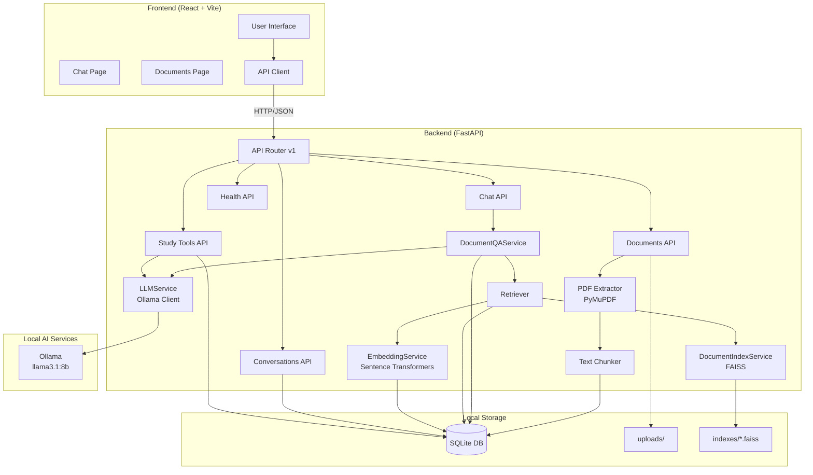

# StudyMate AI

StudyMate AI is a locally-run, retrieval-augmented generation (RAG) application that helps students learn from their academic PDFs by grounding answers strictly in the uploaded documents. Instead of relying on general knowledge, the system retrieves relevant passages from the user's PDFs and uses a local LLM to generate answers with verifiable source citations.

## Table of Contents

- [Project Overview](#project-overview)
- [Features](#features)
- [Technology Stack](#technology-stack)
- [How It Works](#how-it-works)
- [Architecture](#architecture)
- [Prerequisites](#prerequisites)
- [Installation and Setup](#installation-and-setup)
- [Running the Application](#running-the-application)
- [Configuration](#configuration)
- [Usage Guide](#usage-guide)
- [API Documentation](#api-documentation)
- [Testing and Verification](#testing-and-verification)
- [Demo and Submission](#demo-and-submission)
- [Project Structure](#project-structure)
- [Limitations and Future Improvements](#limitations-and-future-improvements)

## Project Overview

**Problem it solves:** Students often need to quickly extract information from long lecture notes, textbooks, or research papers. Manually searching through PDFs is time-consuming and it's easy to miss relevant sections. Additionally, general-purpose LLMs can hallucinate or provide answers not grounded in the specific material being studied.

**Solution:** StudyMate AI allows users to upload PDF documents to a local library. When asking questions, the system performs semantic search over only the selected documents to retrieve relevant passages, then generates answers using a local LLM (via Ollama) with strict grounding rules. Grounded answers include the actual retrieved passages as
sources with page numbers; if the answer isn't found in the uploaded material, the
system explicitly refuses rather than guessing.

After initial setup and model download, the entire application runs locally - PDFs, embeddings, vector indexes, conversations, and LLM inference all stay on the user's machine.

## Features

Verified from the codebase:

- **PDF Upload & Management** - Upload PDFs (max 25 MB by default) with automatic text extraction via PyMuPDF. View document library, inspect document details, and delete documents.
- **Text Extraction** - Extracts text per page from PDFs. Rejects image-only/scanned PDFs with no selectable text (OCR not implemented).
- **Document Processing** - Splits extracted text into page-aware chunks with configurable size (1000 chars) and overlap (150 chars). Persists pages and chunks to SQLite.
- **Local Embeddings** - Generates embeddings using Sentence Transformers with model `all-MiniLM-L6-v2` (384 dimensions). The model downloads once on first use, then runs locally; embeddings are cached in SQLite per chunk.
- **Per-Document Vector Indexes** - Builds FAISS `IndexFlatIP` indexes per document. Indexes are stored in `backend/storage/indexes/{document_id}.faiss` with JSON sidecars. Indexes are built lazily on first query.
- **Grounded Q&A Chat** - Ask questions about one or more uploaded documents. Answers are generated using only retrieved passages with strict grounding rules. Includes real source citations with page numbers.
- **Multi-Turn Conversations** - Follow-up questions use the most recent six messages for context. Conversations are persisted in SQLite and can be created, switched, renamed, restored after refresh, and deleted with inline confirmation.
- **Document-Level Question Handling** - Special handling for broad questions (topics, summary, overview) that samples representative chunks across the document.
- **Source Attribution** - Grounded answers include a `sources` array with actual retrieved passages (document name, page number, chunk ID, similarity score). Source cards expand to show the retrieved text.
- **Deterministic Refusal** - If no retrieved chunks meet the relevance threshold (`RETRIEVAL_MIN_SCORE=0.2`), the API returns the exact message: *"The uploaded material does not provide enough information to answer that question."* without calling the LLM.
- **Summaries** - Generate a grounded, structured summary for a document with headings, key concepts, definitions, and takeaways.
- **Flashcards** - Generate exactly 3-20 source-grounded flip cards from a document, navigate between cards, and restart the session. Every deck is saved automatically.
- **Quizzes** - Generate exactly 3-10 multiple-choice questions with four distinct options and explanations. Answer keys stay on the backend until submission, scoring is server-side, and completed quizzes cannot be resubmitted.
- **Study History** - Browse saved flashcard decks and quizzes, reopen them by query-param URL, and delete them independently. Saved sets show score/status and warn if their source document changed or was deleted.
- **Validated LLM Output** - Flashcard and quiz responses are parsed as JSON and schema-validated against exact requested counts and source-token grounding, with one repair retry for unusable output; summaries are checked for non-empty text. Transport errors and timeouts are never retried blindly.
- **Friendly Failure Modes** - Health-aware error banners and a Retry action for failed questions. Study-tool failures return generic 502/503 messages without internal exception details.
- **Health Monitoring** - `/api/v1/health` endpoint reports API status, database connectivity, and LLM availability.
- **Local-First Architecture** - PDFs, embeddings, indexes, conversations, and LLM inference stay on the local machine. Once Ollama and the embedding model are installed, normal use needs no internet; the embedding model downloads once from Hugging Face.
- **Dark/Light Theme** - UI supports theme switching.
- **Responsive Dashboard** - Sidebar navigation with pages for Dashboard, Documents, Chat, Summaries, Flashcards, Quizzes, Study History, and Settings.

## Technology Stack

### Frontend
- **Framework:** React 19.3.1
- **Build Tool:** Vite 8.3.5 (with Rolldown)
- **Language:** TypeScript 6.0.3
- **Routing:** React Router DOM 7.18.4
- **Styling:** Tailwind CSS 3.4.19 with tailwindcss-animate
- **UI Components:** Radix UI primitives with shadcn/ui patterns
- **Icons:** Lucide React 1.61.0
- **Markdown Rendering:** react-markdown 10.1.0 with remark-gfm 4.0.1
- **Utilities:** class-variance-authority, clsx, tailwind-merge

### Backend
- **Framework:** FastAPI (>=0.115.0)
- **Server:** Uvicorn with standard extras (>=0.32.0)
- **Language:** Python 3.11-3.13 (Python 3.12 recommended)
- **Data Validation:** Pydantic v2 (>=2.9.0), pydantic-settings (>=2.6.0)
- **Database ORM:** SQLAlchemy 2 (>=2.0.36)
- **Database:** SQLite
- **File Upload:** python-multipart (>=0.0.12)
- **HTTP Client:** httpx (>=0.27.2)

### AI/ML (Local)
- **PDF Parsing:** PyMuPDF (pymupdf >=1.24.10)
- **Embeddings:** Sentence Transformers (>=3.2.1) with model `all-MiniLM-L6-v2`
- **Vector Store:** FAISS CPU (faiss-cpu >=1.9.0)
- **Numerical Computing:** NumPy (>=1.26)
- **LLM Runtime:** Ollama (local)
- **Default LLM Model:** `llama3.1:8b` (configurable via `OLLAMA_CHAT_MODEL`)

### Development Tools
- **Testing:** pytest (>=8.3.3), pytest-asyncio (>=0.24.0)
- **Linting:** Ruff (>=0.7.3)
- **Type Checking:** mypy (>=1.13.0)

## How It Works

The RAG pipeline follows these stages:

### 1. PDF Ingestion
1. User uploads a PDF via `POST /api/v1/documents` (multipart/form-data)
2. Backend validates file type (must be `.pdf`), checks size against `MAX_UPLOAD_SIZE_MB` (default 25 MB)
3. File is saved to `backend/storage/uploads/` with a sanitized, unique filename
4. Document record is created in SQLite with status `PROCESSING`

### 2. Text Extraction
1. `extract_pdf_text()` uses PyMuPDF to open and read each page
2. Text is normalized - collapses whitespace while preserving paragraph breaks
3. If no selectable text is found on any page, raises `PDFExtractionError` and document status becomes `FAILED`
4. Per-page text is stored in `document_pages` table

### 3. Text Chunking
1. `chunk_pages()` processes extracted pages in order with `chunk_size` (default 1000) and `chunk_overlap` (default 150)
2. Text is split by paragraphs, preferring paragraph boundaries
3. Oversized paragraphs are hard-split by character budget
4. Each chunk gets an `ordinal`, `page_number`, `text`, and `token_estimate`
5. Chunks are persisted to `document_chunks` table

### 4. Embeddings & Indexing
1. Embeddings are generated lazily on first query using Sentence Transformers with `all-MiniLM-L6-v2`
2. Vectors are cached in `chunk_embeddings` table as float32
3. FAISS `IndexFlatIP` index is built per document and saved to `backend/storage/indexes/{document_id}.faiss` with JSON sidecar
4. On subsequent queries, index is loaded from disk; if missing, rebuilt from cached embeddings

### 5. Retrieval
1. `Retriever` validates documents exist and are ready, enforces `RETRIEVAL_MAX_DOCUMENTS` limit
2. For single-document broad questions (topics/summary/overview), uses document overview retrieval sampling chunks across the document
3. Otherwise performs semantic search across selected documents' indexes, filters hits below `RETRIEVAL_MIN_SCORE` (default 0.2)
4. Results sorted by score descending, limited to `top_k`

### 6. Answer Generation
1. If no chunks retrieved → return refusal message exactly: *"The uploaded material does not provide enough information to answer that question."* (no LLM call)
2. Otherwise call `llm.check_ready()` to verify Ollama availability
3. Build grounded prompt with numbered passages
4. Generate answer via Ollama with strict system prompt forbidding outside knowledge and fabricated citations
5. Strip accidental `[Source N]` markers if present, return answer with sources

### 7. Conversation History
1. Each question is stored as a `user` message and each answer as an `assistant` message linked to a conversation
2. If `conversation_id` is omitted, a new conversation is created and titled from the first question
3. Follow-up prompts include only the six most recent messages, newest last, to keep within the model's context window
4. Replies and message history are persisted, so conversations survive page refresh and backend restarts

### 8. Study Material Generation
1. The study endpoints load the selected document's chunks and validate that it exists and is ready
2. Summaries sample up to 12 chunks across the document so broad prompts see the full document
3. Flashcards and quizzes request exact counts and strict JSON (`flashcards` or `questions`); the selected chunks are bounded and sampled across the document, and too-little content returns `400` before any LLM call
4. Structured output is extracted from optional Markdown fences, parsed, and validated; malformed JSON, wrong counts, duplicate questions/options, content without source-token overlap, or quiz explanations that are too short, unsupported by the source, or unrelated to the correct answer get exactly one repair retry
5. Quiz answer references are resolved by exact text, case-insensitive text, zero-based index, digit string, or `answer_index`; duplicate or simply equivalent options trigger repair, and options are shuffled after resolution while the answer remains the resolved option text
6. Option equivalence checks normalize Unicode, case, and whitespace, and compare simple numbers exactly (decimals, percentages, fractions, thousands separators); they do not attempt general algebraic or unit equivalence
7. Successful decks and quizzes are persisted with the source document ID/label, SHA-256 hash of the selected chunks, selected chunk IDs, and timestamps
8. Quiz answer keys and explanations remain null in saved/list responses until the backend scores a submission; repeated submissions return `409`
9. Timeouts map to a friendly 502 without retrying, unavailable Ollama maps to 503, and internal exception details are never returned

## Architecture



## Prerequisites

- **macOS**
- **Xcode Command Line Tools**: `xcode-select --install`
- **Homebrew**: [https://brew.sh](https://brew.sh)
- **Python 3.11–3.13** (Python 3.12 tested and recommended)
- **Node.js 20.19+ or 22.12+** and npm (required by Vite 8)
- **Ollama** with the `llama3.1:8b` model
- **Internet access on first use** to download the Sentence Transformers embedding model (`all-MiniLM-L6-v2`, about 90 MB)

## Installation and Setup

Run these commands from the repository root (the folder containing `backend/` and
`frontend/`).

### 1. Install System Dependencies (macOS)
```bash
xcode-select --install
/bin/bash -c "$(curl -fsSL https://raw.githubusercontent.com/Homebrew/install/HEAD/install.sh)"
brew install python@3.12 node
```

Verify the versions:
```bash
python3.12 --version   # 3.12.x
node --version         # v20.19+ or v22.12+
npm --version
```

### 2. Backend Setup
```bash
cd backend
python3.12 -m venv .venv
source .venv/bin/activate
python -m pip install --upgrade pip
pip install -e ".[rag,dev]"
cp .env.example .env   # optional; defaults work
```

`.[rag]` installs PyTorch, Sentence Transformers, and FAISS. `.[dev]` adds pytest,
Ruff, and mypy. The first backend start creates `backend/storage/` and its SQLite
database automatically.

### 3. Frontend Setup
From the repository root:
```bash
cd frontend
npm ci                 # reproducible install from package-lock.json
cp .env.example .env   # optional; defaults work
```

If you are continuing in the same terminal from the backend step, use
`cd ../frontend` instead of `cd frontend`.

If you change dependencies, use `npm install` instead of `npm ci`.

### 4. Ollama Setup
```bash
brew install ollama              # or install the macOS app from https://ollama.com/download
ollama pull llama3.1:8b          # chat model used by the app
ollama list                      # confirms the model is installed
```

Only `llama3.1:8b` is required. Retrieval embeddings are generated locally by
Sentence Transformers, not by Ollama.

## Running the Application

Open three terminal windows/tabs:

**Terminal 1 - Ollama** (skip if the macOS app is already running it):
```bash
ollama serve
```

**Terminal 2 - Backend** (from the repository root):
```bash
cd backend
source .venv/bin/activate
uvicorn app.main:app --host 127.0.0.1 --port 8000
```

Restart the backend manually after code changes. Development reload is intentionally
not part of the normal command because reloading while PyTorch and FAISS are loaded can
destabilize the process on macOS.

**Terminal 3 - Frontend** (from the repository root, in a new terminal):
```bash
cd frontend
npm run dev
```

- Backend: `http://127.0.0.1:8000` (API docs at `/docs`)
- Frontend: `http://localhost:5173` (Vite uses `http://localhost:5174` if 5173 is busy)
- Health check: `http://127.0.0.1:8000/api/v1/health`
- Ollama check: `curl http://127.0.0.1:11434/api/tags`

The first chat request may take longer while Sentence Transformers downloads its model
and builds the document index. Run one warm-up chat before a demo. LLM generation
itself is CPU-bound on the test machine and can take minutes; see
[Limitations and Future Improvements](#limitations-and-future-improvements).

## Configuration

Backend settings live in `backend/.env` (copy `backend/.env.example`). Every setting
can also be provided as an environment variable. The table below lists the settings
used in normal local operation.

| Variable | Default | Purpose |
| --- | --- | --- |
| `ENVIRONMENT` | `development` | Runtime environment label |
| `DEBUG` | `true` | Debug flag |
| `HOST` / `PORT` | `127.0.0.1` / `8000` | Backend bind address |
| `CORS_ORIGINS` | `http://localhost:5173,http://127.0.0.1:5173,http://localhost:5174,http://127.0.0.1:5174` | Browser origins allowed to call the API |
| `DATABASE_URL` | SQLite file in `backend/storage/` | SQLAlchemy connection URL |
| `MAX_UPLOAD_SIZE_MB` | `25` | PDF upload limit |
| `OLLAMA_BASE_URL` | `http://127.0.0.1:11434` | Ollama server |
| `OLLAMA_CHAT_MODEL` | `llama3.1:8b` | Chat model |
| `OLLAMA_TIMEOUT_SECONDS` | `600` | Per-request Ollama timeout |
| `EMBEDDING_MODEL` | `all-MiniLM-L6-v2` | Sentence Transformers embedding model |
| `EMBEDDING_DEVICE` | `cpu` | Embedding device |
| `EMBEDDING_BATCH_SIZE` | `32` | Embedding batch size |
| `CHUNK_SIZE` / `CHUNK_OVERLAP` | `1000` / `150` | Retrieval chunking |
| `RETRIEVAL_TOP_K` | `5` | Default retrieved chunks per question |
| `RETRIEVAL_MIN_SCORE` | `0.2` | Minimum cosine similarity; lower-scoring chunks are treated as irrelevant |
| `RETRIEVAL_MAX_DOCUMENTS` | `10` | Maximum documents per question |
| `ANSWER_TEMPERATURE` | `0.1` | Answer generation temperature |
| `ANSWER_MAX_TOKENS` | `512` | Maximum generated answer tokens |
| `ANSWER_TOP_P` | `0.9` | Nucleus sampling threshold |

Frontend settings live in `frontend/.env`:

| Variable | Default | Purpose |
| --- | --- | --- |
| `VITE_API_BASE_URL` | `http://127.0.0.1:8000/api/v1` | Backend API base URL used by the browser |
| `VITE_API_PROXY_TARGET` | `http://127.0.0.1:8000` | Vite development proxy target |

`OLLAMA_EMBED_MODEL` is present in the backend settings for the unused Ollama embedding
helper, but the active retrieval path uses `EMBEDDING_MODEL` and Sentence Transformers.
It is not required for setup.

Do not commit `.env` files. Only `.env.example` files are tracked.

## Usage Guide

1. **Upload a PDF**: Go to Documents page → Upload PDF. Select a PDF with selectable text (max 25 MB). Wait for processing to complete (status becomes ready).
2. **Ask Questions**: Go to Chat page → Select one or more documents → Type your question → Send. Answers include grounded responses and source passages with page numbers.
3. **Continue the Conversation**: Ask follow-up questions that refer to the previous answer. Use the sidebar to create, switch, rename, or delete conversations; the active conversation is restored after refresh.
4. **View Sources**: Grounded answers show retrieved sources with document name, page number, and similarity score. Click a source to expand the exact retrieved text.
5. **Handle Refusals**: If the answer isn't in the documents, you'll get: *"The uploaded material does not provide enough information to answer that question."*
6. **Study**: Open Summaries, Flashcards, or Quizzes, select a document, and generate material. Flashcard decks and quizzes are saved automatically; quiz answers are scored by the backend after submission.
7. **Review Saved Material**: Open **Study History** to browse saved decks and quizzes, reopen them, or delete them. Saved sets warn when their source document was changed or deleted; deleting a document does not delete its saved study history.

## API Documentation

Base URL: `http://127.0.0.1:8000/api/v1`. API metadata is available at
`http://127.0.0.1:8000/` (outside the versioned prefix).

| Method | Endpoint | Description |
|---|---|---|
| `GET` | `/health` | Health check (API, DB, LLM status) |
| `GET` | `/documents` | List all documents |
| `POST` | `/documents` | Upload PDF (multipart/form-data, field `file`) |
| `GET` | `/documents/{id}` | Get document details |
| `DELETE` | `/documents/{id}` | Delete document and files |
| `POST` | `/chat` | Ask a question (JSON: `question`, `document_ids`, optional `top_k`, optional `conversation_id`) |
| `GET` | `/conversations` | List conversations with message counts |
| `POST` | `/conversations` | Create an empty conversation |
| `GET` | `/conversations/{id}` | Get a conversation with its messages |
| `PATCH` | `/conversations/{id}` | Rename a conversation |
| `DELETE` | `/conversations/{id}` | Delete a conversation |
| `POST` | `/study/summary` | Generate a summary (`document_id`) |
| `POST` | `/study/flashcards` | Generate and save 3-20 flashcards (`document_id`, `count`) |
| `GET` | `/study/flashcards` | List saved decks with source state |
| `GET` | `/study/flashcards/{id}` | Get a saved deck |
| `DELETE` | `/study/flashcards/{id}` | Delete a saved deck |
| `POST` | `/study/quiz` | Generate and save 3-10 quiz questions (`document_id`, `count`) |
| `GET` | `/study/quizzes` | List saved quizzes with status, score, and source state |
| `GET` | `/study/quizzes/{id}` | Get a saved quiz; answers remain hidden until submission |
| `POST` | `/study/quizzes/{id}/submit` | Submit all answers for server-side scoring |
| `DELETE` | `/study/quizzes/{id}` | Delete a saved quiz |

See interactive docs at `http://127.0.0.1:8000/docs` for full schemas.

## Testing and Verification

Run these checks from the repository root.

**Backend**
```bash
cd backend
source .venv/bin/activate
python -m pytest -v
python -m mypy app
python -m ruff check app tests
```

**Frontend**
```bash
cd frontend
npm run typecheck
npm run lint
npm run build
```

The frontend has no unit-test runner configured; `typecheck`, `lint`, and the
production build are its verification steps. Current backend result: **114 tests
passed**. See [TESTING.md](TESTING.md) for the full results and manual checklist.

## Demo and Submission

- [DEMO_SCRIPT.md](DEMO_SCRIPT.md) — timed 5–7 minute demonstration with wait points
  and slow-Ollama fallbacks.
- [TESTING.md](TESTING.md) — automated results, live verification, and manual checks.
- [SUBMISSION_CHECKLIST.md](SUBMISSION_CHECKLIST.md) — software requirements, feature
  checklist, screenshots to capture, archive exclusions, and pre-demo checks.

## Project Structure

```
studymate-ai/
├── backend/
│   ├── app/
│   │   ├── api/v1/          # chat, conversations, study, documents, health
│   │   ├── core/            # Config
│   │   ├── db/              # Database setup
│   │   ├── models/          # SQLAlchemy models (documents, conversations, embeddings, study sets)
│   │   ├── schemas/         # Pydantic schemas
│   │   ├── services/        # Business logic
│   │   │   ├── llm/         # LLM service (Ollama)
│   │   │   ├── pdf/         # PDF extraction
│   │   │   └── rag/         # RAG pipeline (chunking, embeddings, retrieval, QA)
│   │   └── main.py
│   ├── tests/               # pytest suite (114 tests; no live Ollama required)
│   ├── pyproject.toml
│   ├── .env.example
│   └── storage/             # local-only uploads, indexes, and SQLite DB (git-ignored)
├── frontend/
│   ├── src/
│   │   ├── components/      # UI components, including chat history and sources
│   │   ├── hooks/           # chat, documents, health, theme hooks
│   │   ├── lib/api.ts       # typed API client
│   │   ├── pages/           # route components
│   │   └── types/           # shared TypeScript types
│   ├── package.json
│   ├── package-lock.json
│   ├── .env.example
│   └── vite.config.ts
├── ARCHITECTURE.md
├── DEMO_SCRIPT.md
├── TESTING.md
├── SUBMISSION_CHECKLIST.md
└── README.md
```

## Limitations and Future Improvements

### Current Limitations
- **Slow local generation** - On the development machine (`llama3.1:8b`, ~4 tokens/s), chat replies take roughly 90-145s and study tools 180-280s. Requests are synchronous and the Ollama timeout is set to 600s to avoid false failures.
- **No OCR** - Only PDFs with selectable text; scanned/image-only PDFs rejected
- **First-run network dependency** - The embedding model is downloaded from Hugging Face once; subsequent processing and inference are local
- **No frontend automated test suite** - Frontend verification is type checking, linting, and a production build
- **English-centric** - Default embedding model untested for other languages
- **Flat FAISS indexes** - Exact brute-force search, may be slower for very large collections
- **Limited conversation context** - Only the six most recent messages are sent to the model; older turns are stored but not used for generation
- **Small local context window** - `llama3.1:8b` runs with a 4096-token context, which limits long answers and retrieved context
- **Lazy index building** - First query per document is slower
- **Single LLM provider focus** - Designed for Ollama; no external provider support
- **Quiz option equivalence** - Validation rejects duplicate text and simple numeric equivalents such as `0.5`, `1/2`, and `50%`, but cannot detect general algebraic equivalence or unit conversions; an earlier live quiz contained two algebraically equivalent radical options
- **Model errors remain possible** - Source-token grounding and answer-specific explanation checks catch clearly unrelated or mismatched output but do not prove semantic correctness, detect every extra true fact, or guarantee correct arithmetic
- **Saved sets can go stale** - Study history stores a source hash and warns when the document changed or was deleted, but it does not automatically regenerate the saved set
- **Local single-user design** - No authentication, multi-user isolation, background job queue, or streaming responses

### Proposed Future Improvements
- **OCR support** for scanned documents
- **Background generation with progress** so long study-tool requests do not block the UI
- **Streaming responses** for chat
- **Hybrid search** with re-ranking and query rewriting
- **Longer conversation memory** with summarization
- **Additional LLM provider support**
- **Better document structure parsing**
- **Evaluation framework** for grounding quality and quiz correctness
